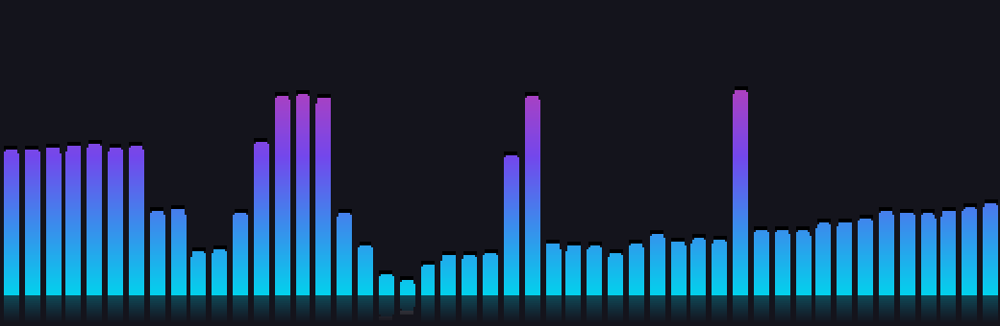
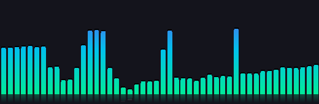
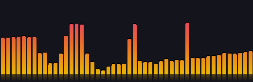

# QQ 音乐频谱悬浮窗

一个跟着音乐跳动的桌面频谱条。**QQ 音乐启动时自动出现，退出时自动隐藏**，隐藏时 CPU 占用为 0。

纯 Win32 P/Invoke + .NET Framework 4.8 实现，单个 **85 KB** 的可执行文件，无需安装任何运行库、无需虚拟声卡、无需管理员权限。



<sub>上图由程序内置渲染器输出（`Spectrum.exe --selftest`），与实际显示效果一致。</sub>

---

## 特性

- **零依赖**：只用 Windows 自带的 .NET Framework 4.8，不打包运行时，不写注册表以外的任何位置
- **零打扰**：`WS_EX_TRANSPARENT` 分层窗口，鼠标点击直接穿透到桌面，不抢焦点、不进任务栏、不挡 Alt+Tab
- **真·省电**：QQ 音乐不运行时彻底 `Stop()` 并释放音频客户端，而不是"空跑"；实测隐藏态 **0.0% CPU**
- **抓系统混音**：WASAPI 环回采集默认播放设备，任何走系统声音的程序（网易云、浏览器、视频播放器）都能驱动
- **高度可调**：48 根对数频段、6 套主题、自定义渐变色、敏感度、频率倾斜补偿、不透明度、倒影、峰值线
- **高 DPI 友好**：Per-Monitor V2，200% 缩放下自动放大，支持多显示器
- **可移植**：零绝对路径，配置和状态都在 exe 同级，整个文件夹拷到别的机器直接能用；开机自启路径漂移会自动修正

## 系统要求

| 项目 | 要求 |
| --- | --- |
| 操作系统 | Windows 10 / 11（Windows 8.1 亦可） |
| 运行时 | .NET Framework 4.8（Win10 1903+ / Win11 自带） |
| 架构 | 任意（x86 / x64 均可运行） |
| 权限 | **无需管理员**，全部写入 `HKCU` |

## 安装

1. 从 [Releases](../../releases) 下载 `QQMusicSpectrum-v1.0.0.zip`
2. 解压到任意目录（例如 `D:\Tools\QQMusicSpectrum\`）
3. 双击 `Spectrum.exe`

首次运行会自动生成带完整中文注释的 `spectrum.ini`，并在屏幕**居中底部**显示频谱条，同时写入开机自启。

> **它不会自己发出声音**，也不需要任何虚拟声卡。

## 使用

### 跟随 QQ 音乐

默认开启（`followqq=true`）。程序每 500ms 增量检查一次 `QQMusic.exe`：

- QQ 音乐启动 → 频谱显示
- QQ 音乐退出 → 频谱隐藏，**同时彻底关闭音频采集**

想让频谱常驻，把 `spectrum.ini` 里的 `followqq` 改成 `false`。

### 托盘菜单

右键托盘图标：

| 菜单项 | 作用 |
| --- | --- |
| 显示 / 隐藏 | 手动开关（关掉后不再自动跟随 QQ 音乐） |
| 主题 | 六套配色：cyber / aurora / sunset / mono / ice / ember |
| 不透明度 | 55% ~ 100% |
| 位置 | 左下 / 右下 / 左上 / 右上 / 居中底部 / 自动贴边 |
| 敏感度 | 0.4 ~ 1.3，柱子跳得多高 |
| 峰值线 / 倒影 | 开关 |
| 跟随 QQ 音乐 | 开关 |
| 开机自启 | 开关（写/删注册表 Run 项） |
| 编辑配置文件 | 用记事本打开 `spectrum.ini` |
| 重新加载配置 | 改完 ini 不用重启程序 |
| 退出 | 关闭程序 |

### 六套主题

| cyber | aurora | sunset |
| --- | --- | --- |
|  |  |  |

另有 `mono`（纯白）、`ice`（冰蓝）、`ember`（暗火）。

## 配置（spectrum.ini）

### `[外观]`

| 键 | 默认 | 说明 |
| --- | --- | --- |
| `width` / `height` | 520 / 170 | 窗口尺寸，96DPI 逻辑单位，高 DPI 自动放大 |
| `bars` | 48 | 频谱柱数量，8–160 |
| `gap` | 3 | 柱间距（像素） |
| `minheight` | 2 | 静音时柱子的最小高度 |
| `theme` | cyber | 命名主题 |
| `colors` | 空 | **自定义配色**，逗号分隔的 `#RRGGBB`，2–8 个色标；填了就覆盖 `theme` |
| `opacity` | 0.92 | 整体不透明度 0.15–1.0 |
| `mirror` | true | 底部倒影 |
| `peaks` | true | 柱顶峰值线 |

自定义配色示例：

```ini
colors=#00E5FF,#7C4DFF,#FF3D9A      ; 青 → 紫 → 粉（从柱底到柱顶渐变）
colors=#FFD166,#FF6B35,#D7263D      ; 琥珀 → 橙 → 红
colors=#FFFFFF,#FFFFFF              ; 纯白
```

### `[位置]`

| 键 | 默认 | 说明 |
| --- | --- | --- |
| `position` | auto | `auto` = 自动贴边；或写具体坐标 `position=1200,760` |
| `align` | center | auto 时的水平对齐：left / center / right（center = 居中底部） |
| `margin` | 24 | 距屏幕边缘的间距（96DPI 逻辑单位） |
| `monitor` | 1 | 1 = 主显示器，2 = 第二块，依次类推 |

> `position=x,y` 里的坐标是**物理像素**。在 200% 缩放的屏幕上，想放到逻辑坐标 (100,200) 就要写 `position=200,400`。

### `[音频]`

| 键 | 默认 | 说明 |
| --- | --- | --- |
| `sensitivity` | 0.8 | 敏感度倍数 0.2–4.0，越大柱子跳得越高 |
| `tilt` | 2.5 | **频率倾斜补偿**（dB/八度）。音乐能量天然低频强、高频弱，补偿后左右高度更均匀；0 = 关闭 |
| `floor` / `top` | -70 / -10 | 频谱上下限（dBFS），floor 越小越灵敏 |
| `attack` | 0.55 | 上升速度 0.05–0.95 |
| `release` | 0.16 | 回落速度 0.02–0.90 |

### `[行为]`

| 键 | 默认 | 说明 |
| --- | --- | --- |
| `followqq` | true | 跟随 QQ 音乐显示/隐藏 |
| `qqprocess` | QQMusic | 监视的进程名（不含 `.exe`，可改成别的播放器） |
| `pollms` | 500 | 进程检测间隔；增量检测，调小几乎不增加开销 |
| `fps` | 60 | 有声音时的帧率（**30 可把 CPU 再降一半**） |
| `idlefps` | 12 | 静音时的帧率 |
| `autostart` | true | 是否开机自启 |
| `log` | false | 是否写 `spectrum.log` |

### 配置优先级

`spectrum.ini` 和 `state.ini` 谁更新（按文件修改时间）就以谁为准：

- 你手动改 `spectrum.ini` → 下次启动 ini 全胜
- 你用托盘菜单改 → 写入 `state.ini` → 重启后保持

想恢复默认，把两个 ini 都删掉重新运行即可。

## 性能实测

测试环境：1600×1000 逻辑 @ 200% 缩放（3200×2000 物理），窗口 520×170（物理 1040×340）。

| 状态 | CPU（单核占比） | 工作集 |
| --- | --- | --- |
| QQ 音乐未运行（隐藏） | **0.0%** | 20.7 MB |
| 显示但静音 | ~0.3% | 27 MB |
| 显示 + 播放 @ 60fps | 3.3% – 5.0% | 27 MB |
| 显示 + 播放 @ 30fps | 2.2% | 27 MB |
| 显示 + 播放 @ 15fps | 1.2% | 27 MB |

线程 13，句柄 332，30 秒稳定性测试内存漂移 0.13 MB（无泄漏）。

省电设计：

- **隐藏时彻底停止音频采集**（`IAudioClient::Stop` 并释放），不是"空跑"
- 静音时自动降到 `idlefps`，且跳过重绘与分层窗口上传
- 进程检测是增量式的（`EnumProcesses` + 只对新 PID 查映像名），比每次全量快照省下约 2% CPU
- 帧计时用高精度可等待定时器，不调用 `timeBeginPeriod`（不抬高系统定时器频率）

嫌 CPU 高就把 `fps` 调到 30。

## 常见问题

**柱子不动 / 一直很矮**

先确认有声音在放。把 `log` 改成 `true` 看 `spectrum.log`，里面会记录音频格式，
例如 `audio: started 48000Hz ch=2 bits=32 float`。若出现 `audio: ... failed`，说明抓不到默认设备。
再试试把 `sensitivity` 调到 1.3，或把 `floor` 调到 -80。

**左右两边高度差很多（左边容易顶到天花板，右边很矮）**

这是音乐频谱的物理常态，不是 bug：音乐能量天然集中在低频（粉红噪声约 -3dB/八度），
而对数频段下低频段自然更高。程序默认用 `tilt=2.5` 做倾斜补偿来缓解。
想更平就调大 `tilt`（例如 4.0），想还原原始比例就设 `tilt=0`。
注意右侧极高频在 MP3/AAC 里常被编码器直接切掉，那几根柱子本来就接近静音。

**窗口跑到屏幕外了**

删掉 `state.ini` 重启。程序会把窗口夹回可见区域，但如果坐标是手写在 ini 里的，需要自己改回来。

**想让它跟着别的播放器**

把 `qqprocess` 改成那个程序的进程名（不含 `.exe`），例如 `qqprocess=cloudmusic`。

**怎么彻底卸载**

托盘菜单 →「开机自启」取消勾选（或手动删注册表
`HKCU\Software\Microsoft\Windows\CurrentVersion\Run\QQMusicSpectrum`），
然后退出程序、删掉整个文件夹即可。程序不写任何其它位置。

## 技术实现

- **音频**：WASAPI 环回（`AUDCLNT_STREAMFLAGS_LOOPBACK`），事件驱动，无轮询
- **分析**：2048 点迭代基 2 FFT，Hann 窗，48 个对数频段（35Hz 起），攻击/释放包络，可选倾斜补偿
- **渲染**：分层窗口 + 32bpp 预乘 alpha DIB，每帧一次 `UpdateLayeredWindow`，渐变 LUT 预乘
- **UI**：纯 Win32（无 WinForms / WPF / GDI+），单文件 85 KB，冷启动 < 100ms
- **可移植性**：零绝对路径；尺寸按 DPI 缩放；支持多显示器；自启路径漂移自动修正

## 从源码构建

只需要系统自带的 .NET Framework（Windows 10/11 都有），**不需要安装 SDK**：

```cmd
build.cmd
```

它调用 `C:\Windows\Microsoft.NET\Framework64\v4.0.30319\csc.exe` 编译 `src\*.cs`，输出 `Spectrum.exe`。

自检（不开窗口，渲染六套主题到 BMP 并校验 FFT）：

```cmd
Spectrum.exe --selftest
```

结果写入 `selftest.txt` 和 `selftest_<theme>.bmp`。

## 命令行参数

| 参数 | 说明 |
| --- | --- |
| `--tray` | 启动时直接进托盘，不显示窗口（开机自启用的就是它） |
| `--selftest` | 跑自检，不创建窗口，结束后退出 |

## 目录结构

```
QQMusicSpectrum/
├─ Spectrum.exe      ← 主程序（唯一需要的可执行文件）
├─ spectrum.ini      ← 配置文件（首次运行自动生成，带完整中文注释）
├─ state.ini         ← 运行状态（托盘改过的选项存这里，可删）
├─ spectrum.log      ← 日志（ini 里 log=true 时才写）
├─ src/              ← 源码（C# 5，约 1900 行）
├─ tools/            ← 构建与测试脚本
└─ docs/             ← 预览图
```

## 许可证

[MIT](LICENSE)
